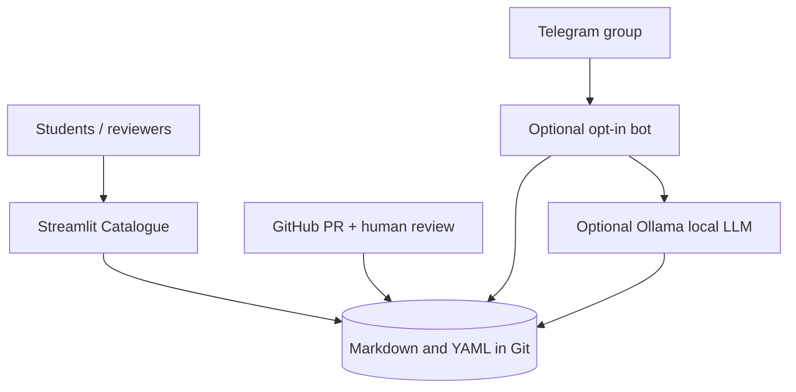

# Lightweight architecture

## Data boundaries
- Public Git: curated academic content only; no raw group histories, access tokens, or identifiable private interview data.
- Telegram: third-party transport. Access to group conversations requires the bot's permissions and announced/approved policy.
- Local server: inference and optional private, retention-limited message cache.
- Human approval: curation, publication, private-data handling, external dissemination.

## Implementation strategy
Phase 1: local file catalogue + tests. Phase 2: submissions/peer review + content checks. Phase 3: bot and local LLM if time allows. Use PostgreSQL/pgvector only when actual retrieval needs justify complexity.
